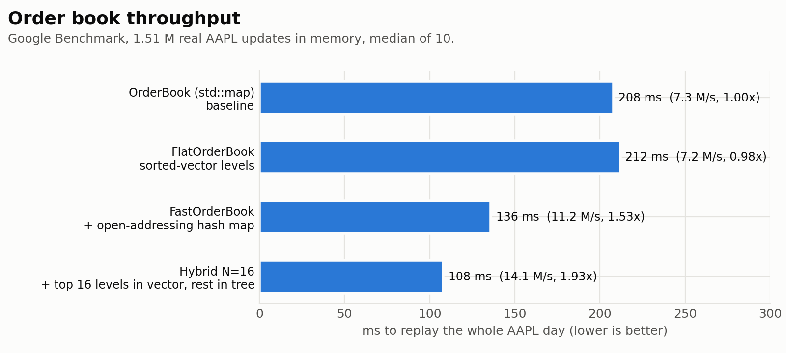
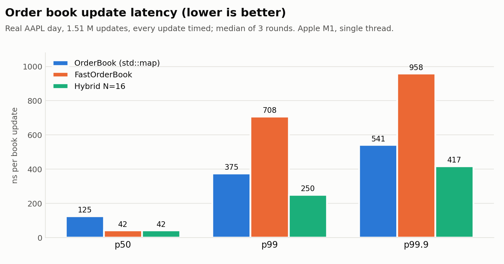
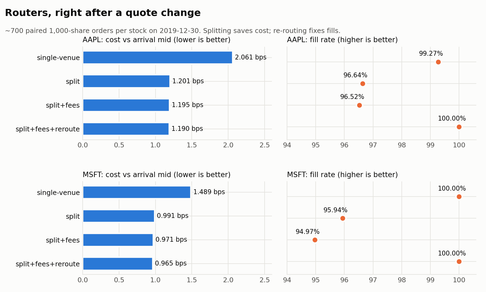
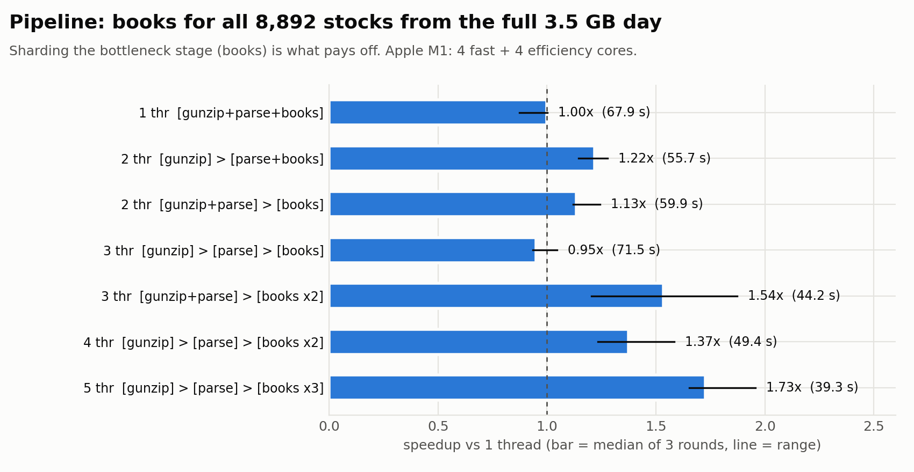

# Apex — Low-Latency Multi-Venue Trading Engine

Apex is a C++20 engine that rebuilds order books from **real NASDAQ market data**, routes
orders across three trading venues for the best all-in price, and processes a full trading
day (268.7 million messages, all 8,892 stocks) with a lock-free multithreaded pipeline.
Every number below comes from a real run on a real NASDAQ day, with the hardware and method
stated.

**Stack:** C++20 · CMake · GoogleTest · Google Benchmark · zlib · Python (matplotlib) for charts
· Docker. It builds and passes all **110 tests** with Apple clang on macOS and with GCC on Linux.

## Highlights

| | Result |
|---|---|
| **Correct on real data** | Rebuilds every book from NASDAQ ITCH 5.0 (2019-12-30) with **0 rejected updates** and **0 crossed books**. All book designs and all thread layouts produce identical results. |
| **Fast order book** | A hybrid book (best 16 price levels in a sorted vector, deeper levels in a tree, plus an open-addressing hash map) is **1.93x the throughput** of a `std::map` book, with p50 / p99 of **42 / 250 ns** per update versus 125 / 375 ns. |
| **Fast parser** | Decodes ITCH at **108.6 M messages/s** (9.2 ns per message). |
| **Smart order routing** | Right after quote changes, it's **42% cheaper than single-venue routing for AAPL** (2.061 → 1.190 bps) and **35% cheaper for MSFT** (1.489 → 0.965 bps), with **100% of shares filled** thanks to wave-based re-routing. A routing decision takes **598 ns**. |
| **Multithreaded pipeline** | Books for all 8,892 stocks from the 3.5 GB compressed file in **39.3 s versus 67.9 s on one thread (1.73x)**, using lock-free SPSC queues and per-stock sharding. |

<sub>Apple M1 (4 performance + 4 efficiency cores, 8 GB), Release build. Details and every raw
number: [docs/RESULTS.md](docs/RESULTS.md) and [results/](results/).</sub>

## Results

### Order book: what each change was worth

<picture>
  <source media="(prefers-color-scheme: dark)" srcset="results/charts/book_throughput-dark.png">
  
</picture>

Changing one piece at a time showed where the time actually went. Moving the price levels
into a cache-friendly sorted vector changed **nothing**. Benchmarking the hash map on its
own showed it was about half the cost, so replacing `std::unordered_map` with an
open-addressing table gave the first real speedup.

<picture>
  <source media="(prefers-color-scheme: dark)" srcset="results/charts/book_latency-dark.png">
  
</picture>

The faster book had a worse tail: p99 was 708 ns versus 375 ns. Measuring the real book
explained why. AAPL's book reaches 4,227 price levels, and about 6% of new levels forced the
vector to shift 100 or more entries. The **hybrid** book keeps only the best 16 levels in the
vector and the rest in a tree, which fixed the tail while keeping the fast median.

### Smart order routing

<picture>
  <source media="(prefers-color-scheme: dark)" srcset="results/charts/router-dark.png">
  
</picture>

Splitting orders across venues cuts cost, but the slow venue's quotes are often gone by the
time a child order arrives (1 ms later), so fills dropped to 95–96.5%. **Re-routing in
waves** (wait for fill reports, then send the missing shares on the current books) brings
fills to 100% and keeps the savings. The trade-off is time: p99 time-to-finish rises from
1 ms to about 3.4 ms.

### Multithreaded pipeline

<picture>
  <source media="(prefers-color-scheme: dark)" srcset="results/charts/pipeline-dark.png">
  
</picture>

Each thread records how long it waits on its queues, and the thread that never waits is the
bottleneck. That was the **books stage** (8,892 books don't fit in cache). Giving the parser
its own thread *slowed things down* (0.95x), while sharding the books across 3 threads gave
the best result. It isn't 3–5x because the M1 has only 4 performance cores and every thread
shares memory bandwidth.

## How it works

Two programs share the same decoder and order books.

**1. Market-data pipeline** (`apex_pipeline`): books for every stock, multithreaded.

```
 NASDAQ ITCH 5.0 (.gz, 3.5 GB)
        │
        ▼
 ┌───────────────┐  buffers   ┌────────────────┐  events   ┌──────────────────────────────┐
 │ gunzip thread │ ──SPSC───▶ │ parse thread   │ ──SPSC──▶ │ book threads, sharded by      │
 └───────────────┘  queue     │ (ITCH decoder) │  queues   │ stock: a HybridOrderBook for  │
                              └────────────────┘           │ each of the 8,892 stocks      │
                                                           └──────────────────────────────┘
```

**2. Routing experiment** (`apex_route`): one stock, three simulated venues.

```
 NASDAQ ITCH 5.0 ──▶ Market simulator: the stock's real orders split across venues
                     A / B / C (50/20/30%), each with its own fee and latency
                              │ venue books at decision time
                              ▼
                     Router + OrderManager: split by price + fee, send child orders,
                     wait for fill reports, re-route what didn't fill
                              │ fills
                              ▼
                     Execution analytics: cost vs arrival mid (bps), fill rate,
                     time to finish, decision latency
```

| Component | File | What it does |
|---|---|---|
| ITCH decoder | [`itch.hpp`](include/apex/itch.hpp) | Big-endian binary decode of the 7 message types that change the book, as a template (no virtual calls) |
| File reader / framer | [`itch_file_reader`](include/apex/itch_file_reader.hpp), [`pipeline.hpp`](include/apex/pipeline.hpp) | Streams the `.gz` file through zlib without unpacking it to disk, and rebuilds frames split across chunks |
| Order books | [`order_book`](include/apex/order_book.hpp), [`flat_order_book.hpp`](include/apex/flat_order_book.hpp) | `std::map` baseline, plus flat and hybrid books built from pluggable level stores and hash maps |
| Hash map | [`order_map.hpp`](include/apex/order_map.hpp) | Open addressing, linear probing, Fibonacci hashing, backward-shift deletion |
| Venues | [`market_simulator`](include/apex/market_simulator.hpp) | Splits real orders across venues by hash; child orders fill against the book as of *send time + latency* |
| Routers | [`router`](include/apex/router.hpp), [`order_manager`](include/apex/order_manager.hpp) | Single-venue baseline, split by price, split by price + fee, and wave-based re-routing |
| Analytics | [`analytics`](include/apex/analytics.hpp) | All-in cost against the arrival mid in bps, fill rate, nearest-rank percentiles |
| Lock-free queue | [`spsc_queue.hpp`](include/apex/spsc_queue.hpp) | Acquire/release ring buffer, cached counters, counters on separate cache lines |
| Pipeline | [`pipeline`](include/apex/pipeline.hpp) | 1 to N threads running the same code, checked with a per-stock checksum |

More design detail: [docs/ARCHITECTURE.md](docs/ARCHITECTURE.md).

## How correctness is checked

- **Rebuilds real data exactly:** replaying real NASDAQ data gives 0 rejected updates, 0 crossed
  books, and an empty book at the close (day orders expire), for AAPL, MSFT, SPY and all
  8,892 stocks.
- **Differential tests:** every book design runs the same 50,000 random operations, and the full
  book must match after every step. The same holds on 4.86 M real updates, including all
  4,720 AAPL price levels compared at 12:00.
- **Venue split:** the three venue books always add up exactly to the real book.
- **Lock-free queue:** 5 M values pass between two threads with no gaps or repeats.
- **Pipeline:** every thread layout must produce the same checksum of every stock's best bid
  and ask after every update, including with 37-byte chunks that split almost every message.
- **Portable:** builds on Apple clang (macOS) and GCC (Linux, via Docker).

## Honest limitations

- **Simulated venues:** there's one real exchange in the data. Venues A, B and C are simulated
  by splitting NASDAQ's real orders between them, and their fees and latencies are assumed
  values, not any real exchange's.
- **No market impact:** our own fills don't remove liquidity from the simulated books, which is
  reasonable only for small, spaced-out orders, and that's how the experiments are designed.
- **One day, one machine:** one trading day (2019-12-30), routing evaluated on AAPL and MSFT,
  all timings on one laptop. Pipeline timings vary up to about ±15% between runs (macOS
  decides which core runs each thread), so the README reports medians of repeated runs.
- **Timer resolution:** the clock on this machine ticks every 41 ns, so p50 values near 42 ns
  mean "about one tick."
- **Replay, not live:** the pipeline's queue hand-off latency (milliseconds) reflects queues
  kept full by an as-fast-as-possible replay, not a live feed.
- **Not covered:** no network stack, kernel bypass, or exchange order-entry protocol.

## Build and run

```bash
cmake -S . -B build && cmake --build build -j && ctest --test-dir build --output-on-failure
```

You need CMake 3.20 or newer, a C++20 compiler and zlib. GoogleTest and Google Benchmark
download automatically.

**Get the data.** NASDAQ publishes free full-day ITCH 5.0 files at
https://emi.nasdaq.com/ITCH/Nasdaq%20ITCH/. This project uses `12302019.NASDAQ_ITCH50.gz`
(3.52 GB). Put it in `data/`; the `.gz` file is read directly.

```bash
./build/apex_replay   data/12302019.NASDAQ_ITCH50.gz AAPL 12:00   # rebuild one book, print it at noon
./build/apex_route    data/12302019.NASDAQ_ITCH50.gz AAPL         # compare routing strategies
./build/apex_pipeline data/12302019.NASDAQ_ITCH50.gz 3            # all stocks, every thread layout
./build/apex_extract  data/12302019.NASDAQ_ITCH50.gz AAPL data/AAPL.itch   # small file for benchmarks
./build/apex_bench    data/AAPL.itch                              # Google Benchmark suite
./build/apex_latency  data/AAPL.itch 3                            # per-update percentiles
```

**Docker (Linux, GCC).** This builds and runs all tests; mount the data folder to use the tools:

```bash
docker build -t apex .
docker run --rm -v "$PWD/data:/apex/data:ro" apex apex_replay data/12302019.NASDAQ_ITCH50.gz AAPL 12:00
```

**Charts.** Generate them from the measured CSVs:

```bash
python3 -m venv .venv && .venv/bin/pip install -r scripts/requirements.txt
.venv/bin/python scripts/plot_results.py
```

## Repository layout

```
include/apex/   headers (decoder, books, hash map, simulator, routers, queue, pipeline)
src/            implementations
tools/          apex_replay, apex_venues, apex_route, apex_extract, apex_pipeline
bench/          apex_bench (Google Benchmark), apex_latency, apex_depth
tests/          110 GoogleTest tests
results/        measured numbers (CSV) and the charts made from them
docs/           ARCHITECTURE.md (design), RESULTS.md (step-by-step measurements)
scripts/        plot_results.py
```
